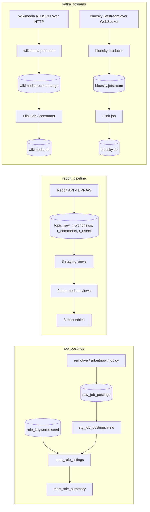

# AGENTS.md

Orientation for the `AmanLP7/dbt` checkout: three Databricks pipelines sharing one
SQL warehouse, one credential flow, and one Python environment.

- **Hard invariants** live in `.omp/RULES.md`. OMP loads that file in every project
  directory (via symlinks); §7 summarizes it, the rules file is authoritative.
- **Per-project detail** is in each project's `README.md`.
- This file is the map: what lives where, how data moves, and which command runs what.

## 1. Warehouse access

Ad-hoc Databricks SQL goes through the MCP server `databricks`; the CLI and
`databricks-sql-connector` are fallback only. The invariants that govern this are in
`.omp/RULES.md` — the material below is context, not a second copy of the rules.

Workspace `dbc-280fcd4a-642e.cloud.databricks.com` (Express trial, AWS `us-west-2`,
workspace id `7474652715826449`). One SQL warehouse, `5c5d597ca7af9460`: serverless
2X-Small, `auto_stop_mins: 1`. That pairing is the cost floor — 4 DBU/hr while it
runs, and idle billing capped at about 0.07 DBU instead of 2.0 per session, at the
price of one ~5 s cold start after every idle gap.

| Schema | Holds | Written by |
| --- | --- | --- |
| `workspace.job_postings` | `raw_job_postings`, seed `role_keywords`, `stg_job_postings`, `mart_role_listings`, `mart_role_summary` | `job_postings` extractor, then `dbt build` |
| `workspace.reddit` | 3 staging views, 2 intermediate views, 3 mart tables | `reddit_pipeline` `dbt build` |
| `workspace.topic_raw` | `r_worldnews`, `r_comments`, `r_users` | `reddit_pipeline` extractors |
| `workspace.bluesky` | `raw_bluesky` — 13 `STRING` columns mirroring `main.events`, clustered on `event_dt`; created 2026-10-28, empty | nothing yet; `kafka_streams/bluesky/` writes SQLite only |

There is no `workspace.wikimedia` on this workspace. The retired consumer's Delta table
belongs to the previous workspace and was not recreated; `kafka_streams/wikimedia/`
writes SQLite only, so nothing needed it.

The server is Databricks' own `system.ai.dbsql`, reached at
`https://dbc-280fcd4a-642e.cloud.databricks.com/ai-gateway/mcp-services/system.ai.dbsql`.
It advertises `execute_sql` and `poll_sql_result`. `execute_sql` can write, so the
read-only guarantee is the caller's identity rather than a tool name: `.omp/mcp.json`
sends a `Bearer` header for the service principal `omp-dbsql-ro`
(applicationId `2848e97e-e449-400f-9088-c33275d535d0`), minted per connection by
`~/.config/omp/dbsql-token.py`.

- That principal holds `USE_CATALOG` on `workspace`, `USE_SCHEMA` + `SELECT` on
  `workspace.{job_postings,reddit,topic_raw,bluesky}`, and `CAN_USE` on the warehouse. It holds
  no `CREATE`, `INSERT`, `UPDATE`, `DELETE`, or `MODIFY` anywhere, so every write path
  ends in `PERMISSION_DENIED` inside Unity Catalog.
- `system` / `system.ai` access is inherited from its `account users` membership. The
  workspace user is not a metastore admin, so those two grants cannot be issued directly
  and must not be attempted.
- The token comes from an OAuth client secret, not a PAT: `client_credentials` against
  `/oidc/v1/token` with scope `all-apis`, one-hour lifetime, cached in
  `~/.config/omp/.dbsql-token-cache` and re-minted on demand. The secret lives in
  `~/.config/omp/dbsql-client.json` (mode 600) and expires 2028-10-23. `create-obo-token`
  is blocked for this principal on this workspace; do not retry it.
- OMP caches the resolved header for the lifetime of the process, so a session open for
  more than an hour loses SQL until `/mcp reconnect databricks` re-mints it.

An MCP write probe does not raise an HTTP error: `execute_sql` answers HTTP 200 with
`status.state: FAILED`, `error_code: BAD_REQUEST`, `sql_state: 42501`, and a
`PERMISSION_DENIED: Principal 'omp-dbsql-ro' does not have …` message, while `isError`
stays `false`. Read the body, not the status code.

The fallback identity is different: the Databricks user `ak547276@gmail.com` (CLI profile
`DEFAULT`) owns all three schemas and every table in them — recorded in the
`information_schema` owner columns, not as grants — including every dbt-produced
relation. The fallback channel can therefore write, which is why the write gate in
`.omp/RULES.md` is absolute; read there for the error taxonomy and fallback conditions.

Authentication is the Databricks CLI profile `DEFAULT`; an ambient `DATABRICKS_PAT`
is stale — do not use it, and `~/.databrickscfg` keeps `default_profile = DEFAULT` so a
bare `databricks` call resolves to this workspace rather than the old `FREE` one.

MCP registration is per working directory. OMP reads only the `.omp/` of its cwd and
does not walk ancestors, so each project carries symlinks to the root
`.omp/{mcp.json,config.yml,RULES.md}`. A new project directory needs the same three
links before a session starts inside it; links added mid-session take effect only
after a restart.

## 2. Repository map

| Path | What it is |
| --- | --- |
| `.omp/` | OMP settings shared by all three projects: `mcp.json` (the read-only SQL server), `config.yml` (deny rule and access notes), `RULES.md` (hard invariants). |
| `.venv/` | The only Python environment in the checkout; no project directory has one. |
| `AGENTS.md` | This orientation. |
| `dbt_readme.md` | Personal dbt notes. Gitignored; not authoritative for this repo. |
| `logs/` | Root dbt log output. Gitignored. |
| `job_postings/` | dbt project + keyless job-board extractors + Dagster code location. |
| `reddit_pipeline/` | dbt project + Reddit extractors + Dagster code location + agent skills. |
| `kafka_streams/` | Kafka flows. Shared broker + shared Python config, one folder per flow. `wikimedia/` sinks the Wikimedia firehose into SQLite (Flink SQL job or Python consumer) and `bluesky/` sinks the Jetstream firehose (Flink SQL job only — its Python consumer was deleted). No dbt project. |

There is **no root-level dbt project**. `dbt` resolves `dbt_project.yml` from the
current directory, so run it from inside `job_postings/` or `reddit_pipeline/`.

## 3. Data flow



The Wikimedia firehose used to be consumed straight into `workspace.wikimedia.raw_wikimedia`
by a top-level `wikimedia/` consumer. That consumer was removed on 2026-10-20 in favour of
`kafka_streams/wikimedia/`; the Delta table lives on the previous workspace only and was
not recreated here, and nothing writes it now.

Each pipeline is independently runnable: extractors and the consumer are plain Python
modules, and dbt runs from inside the project directory. Dagster wraps the same steps
in one ordered job and adds retries, asset checks, and (for `job_postings`) a stopped
daily schedule.

## 4. Projects

### `job_postings/`

ELT over three keyless job-board APIs. The extractor normalises each board's payload
into the shared raw schema and applies no role filter; role matching is a SQL concern
applied in the marts against a seed.

| Path | Contents |
| --- | --- |
| `models/staging/jobs/` | `stg_job_postings` (view) — newest fetch per `(source, source_job_id)`, `job_key`, normalised title, unpacked tags, stripped HTML — plus `src_jobs.yml` (source `jobs.raw_job_postings`, 4 source tests) and `stg_jobs.yml` (3 model tests). |
| `models/marts/jobs/` | `mart_role_listings` and `mart_role_summary` (tables), 7 model tests, all declared in `marts.yml`. |
| `seeds/role_keywords.csv` | 11 keywords across 4 role families; the taxonomy the marts join against. |
| `ingestion/jobs/` | `fetch_job_postings.py` (remotive in one request; arbeitnow and jobicy paginated, with pacing between pages) and `_common.py` (env validation, DDL, chunked parameterised inserts). |
| `orchestration/` | Dagster code location `job_postings_orchestration.definitions`: job `job_board_refresh`, assets `jobs/raw_job_postings` + 4 dbt assets, 14 asset checks, schedule `daily_job_board_refresh` (cron `0 6 * * *`, ships stopped). |
| `tests/` | Offline pytest: extractor mappings, raw-table contract, seed contract, Dagster wiring, extractor asset. |
| `profiles/profiles.yml` | target `dev`, catalog `workspace`, schema `job_postings`. |

- `raw_job_postings` is append-only and stamped `ingested_at`; dedupe happens in
  staging on the newest row per `(source, source_job_id)`.
- Mart matching is a case-insensitive substring of the normalised title with no word
  boundary — `ai engineer` also matches "Dubai engineer". Wildcard characters in a
  keyword are rejected by `test_seed_contract.py`.
- `open_listings` means "postings seen and not re-listed differently", not "jobs open
  today": nothing expires from the raw table.

### `reddit_pipeline/`

ELT over r/worldnews posts, their comments, and commenter profiles.

| Path | Contents |
| --- | --- |
| `models/staging/reddit/` | `stg_reddit_posts`, `stg_reddit_comments`, `stg_reddit_users` (views), with `src_reddit.yml` and `stg_reddit.yml`. |
| `models/intermediate/reddit/` | `int_posts_enriched`, `int_comments_enriched` (views) — joins and business logic. |
| `models/marts/reddit/` | `mart_post_summary`, `mart_user_metrics` (tables), `mart_comment_history` (incremental, merge). All three call `add_audit_fields()`. |
| `ingestion/reddit/` | One module per entity plus `_common.py`: clients, env validation, table setup, both load strategies. |
| `orchestration/` | Dagster code location `reddit_pipeline_orchestration.definitions`: job `reddit_refresh`, 11 assets (3 extractors + 8 dbt), 28 asset checks, no schedule. |
| `macros/` | `add_audit_fields()` and `window_hours()` (the dbt-side 5-hour window). |
| `tests/` | Offline pytest: extractors, Dagster wiring, extractor assets, window contract. |
| `.agents/skills/` | Skills `lint-and-typecheck`, `dbt-model-conventions`, `reddit-extraction`; list them from this directory with `omp skill list`. |
| `profiles/profiles.yml` | target `dev`, catalog `workspace`, schema `reddit`. |

- Sources are `workspace.topic_raw.{r_worldnews,r_comments,r_users}`. Freshness
  thresholds (12 h warn, 24 h error on `ingested_at`) are declared but inert: no job
  or CI step runs `dbt source freshness`, and `dbt build` does not check freshness.
- Posts and comments use a rolling 5-hour window: delete the window, insert the
  fetched rows inside it, keep older rows. Users use a key-based upsert.
- The DELETE and INSERT are separate statements, so a failure between them leaves the
  window rows absent; a retry re-fetches and rewrites them.
- 4 of the 28 asset checks are `relationships` tests marked `severity: warn`, so a
  green build does not prove referential integrity.

### `kafka_streams/`

Kafka flows, independent of the dbt projects and of Databricks. The broker is
one container from `docker-compose.yml` (single-node KRaft, 512 MiB heap under a
1 GiB limit, advertised on `localhost:9092`, 7-day retention); `confluent-kafka`,
`requests`, `websockets`, and `python-dotenv` are installed once at the checkout
root; `.env`, `requirements*.txt`, and `pyproject.toml` live at `kafka_streams/`,
not per flow.

`kafka_streams/wikimedia/` is the first flow: `ingestion/wikimedia/producer.py`
bridges the public NDJSON firehose into `wikimedia.recentchange`, and two
interchangeable readers write that topic into `wikimedia/data/wikimedia.db`
(`main.events`, `main.kafka_offsets`) — `ingestion/wikimedia/flink_job.py`
(Flink SQL) and `ingestion/wikimedia/consumer.py` (Python). Progress is stored in
SQLite; Kafka's committed offsets are unused — never committed, and never a
fallback. One reader per database file, because SQLite WAL allows one writer, and
the Flink job pins parallelism to 1 for the same reason.

The Flink job needs a second environment, `.flink-venv` (`requirements-flink.txt`):
`apache-flink` pulls `apache-beam`, which requires `protobuf<6`, while dbt requires
`protobuf>=6`. Installing it into `.venv` breaks the dbt projects. It also needs a
JDK 17 (`JAVA_HOME`) and four jars in `wikimedia/lib/` — three from Maven Central
via `lib/fetch-jars.sh`, plus `lib/flink-connector-sqlite-4.1.0-2.2.jar` compiled
by `lib/build-sqlite-dialect.sh` from `lib/sqlite-dialect/`, because Flink ships
no SQLite `JdbcDialect`. The job is Flink SQL rather than a PyFlink dataflow: the
events table needs each message's `partition` and `offset`, which only the SQL
connector exposes as metadata columns.

The sink is at-least-once in both readers and deduped by `INSERT OR IGNORE` on
`event_id`. The Python consumer writes its cursor in the same transaction as the
rows; the Flink sink cannot, so `heal_cursor` derives it from `MAX(offset)+1` per
partition at startup and after a clean exit — forward only, so a crash costs a
replay, never a gap.

The Flink MiniCluster serves the stock Web Dashboard on a pinned REST port
(`WIKIMEDIA_FLINK_REST_PORT`, default 8081; it takes the next free port up to +9
and logs the URL). Opening it while the job runs gives the job graph, per-operator
counters, and the failing exception without re-running anything.

Two resume guards, shared via `_kafka.py`: a checkpoint records the Kafka
`cluster_id`, so a recreated broker resets instead of landing inside a fresh log;
and a stored offset below the log's earliest offset (retention deleted it) stops
the process rather than silently skipping the range — `--allow-gap` is the
explicit override. The broker writes to the `kafka_streams_data` volume
(`KAFKA_LOG_DIRS`), so `docker compose down` keeps the topic; `down -v` does not.
The bluesky flow adds a third: the Kafka *topic* id, which is the only thing that
catches a topic deleted and recreated on the same broker — the cluster id
survives that, and the new log restarts at 0 behind a checkpoint that still looks
plausible.

`kafka_streams/bluesky/` is the second flow, same shape one protocol over:
`producer.py` bridges the Jetstream v2 WebSocket (`wss://…/subscribeEvents`,
subprotocol `xrpc.v1.json`, mandatory) into `bluesky.jetstream`, and a Flink SQL
job writes that topic into `bluesky/data/bluesky.db`. This flow has one reader:
its Python consumer was deleted on 2026-10-28, and `flink_job.py` is the only
process that polls the topic. Two things differ from Wikimedia and both are
load-bearing:

- **`main.events` is keyed on `seq`, not on a record URI.** One record has several
  events (a `create`, then an `update` or `delete`); keying on the `at://` URI
  discarded 15 of the first 3,500 messages (0.43%). `record_key` remains as an
  indexed lookup column. `seq` is Jetstream's own per-event counter, so a replay
  still dedupes.
- **The producer keeps its own upstream position** in `main.jetstream_cursor`, the
  microsecond `time` of the newest event librdkafka acknowledged, persisted every
  500 events. Jetstream clamps a cursor older than ~36.9 h (measured: 132,742 s) to
  the oldest retained event instead of rejecting it, so the producer compares the
  first replayed event's age with the age the cursor implied and logs an ERROR when
  the server clamped. A clamped run cannot catch up — replay measured 451 events/s
  against the live 297/s — so rejoining the live edge needs `--live`.

The producer holds the same file lock as the reader, so it must be stopped (or
pointed at another `--db`) while the job starts. Its Flink dashboard defaults to
port 8082, so both flows' jobs can run at once.

Adding a flow means a new topic, a new SQLite file, and `<FLOW>_`-prefixed keys in
`kafka_streams/.env`; it does not mean a second broker.

## 5. Shared conventions

### dbt project shape

- One dbt project per pipeline; each `dbt_project.yml` names the project and its
  profile.
- Materialisation is keyed by layer directory in `dbt_project.yml` and inherited by
  source-named subfolders: `staging` → view, `intermediate` → view (reddit only),
  `marts` → table. A model can override it with `{{ config(...) }}`
  (`mart_comment_history` does).
- Each layer keeps one subfolder per source — `jobs/`, `reddit/` — so a second source
  sits beside the first without changing the layer config.
- Sources are declared in `models/staging/<source>/src_*.yml`. `reddit_pipeline` pins
  `workspace.topic_raw`; `job_postings` resolves `JOB_POSTINGS_CATALOG` /
  `JOB_POSTINGS_SCHEMA` with the target as fallback, matching the extractor.
- Seeds exist only in `job_postings`. `analyses/`, `snapshots/`, and reddit's
  `seeds/` are placeholders.
- Macros live in `macros/`; sqlfluff resolves them via `load_macros_from_path`.
- `tests/` is both dbt's singular-test directory and pytest's directory. dbt reads
  only `.sql` from it, so the Python suite is invisible to dbt.

### Python and credentials

- Python 3.10. Both dbt projects configure ruff (line length 120) and pyright in
  `pyproject.toml` and carry a `.sqlfluff` for the `databricks` dialect.
  `kafka_streams/pyproject.toml` configures ruff and pyright for that tree.
- Install into the root `.venv`, never as `uv tool` copies — `~/.local/bin` precedes
  the pyenv shims and would shadow the environment's `dbt`/`python`.
- Configuration is per-project `.env`, copied from `.env.example` and gitignored.
  Extractors call `load_dotenv()`; **dbt does not read `.env`**.
- One `databricks auth login` covers everything. Extractors hand the SQL connector a
  credentials provider; Dagster mints `DATABRICKS_TOKEN` immediately before each dbt
  run; a manual `dbt` needs the token exported first.
- The ambient `DATABRICKS_PAT` is stale and rejected — do not use it.

### Profiles and dbt invocation

Both dbt projects commit `profiles/profiles.yml` and carry a `profiles.yml` symlink to
it, so a bare `dbt` inside either project finds the repo profile instead of
`~/.dbt/profiles.yml` — which still describes the previous FREE workspace and an expired
literal PAT. Passing the directory explicitly works in both:

```bash
DBT_PROFILES_DIR=profiles dbt build
```

### Testing and CI

- Offline pytest (stubbed HTTP and warehouse) is the pre-merge gate. dbt's own tests
  need a warehouse and run inside `dbt build`.
- `job_postings` pytest reads `target/manifest.json`, so run `dbt parse` first on a
  fresh checkout. `reddit_pipeline`'s `conftest.py` parses the project itself.
- Both dbt projects carry `.github/workflows/ci.yml`; `kafka_streams/` has no workflow.
  GitHub Actions reads workflows only from the repository root
  `.github/workflows`, which this checkout does not have, so in the current layout
  these are local definitions rather than running CI.

## 6. Commands

Run from the project directory. `dbt build` writes to the warehouse; the write gate in
`.omp/RULES.md` governs hand-written statements, not the build itself.

| Task | `job_postings/` | `reddit_pipeline/` |
| --- | --- | --- |
| Install | `pip install -r requirements.txt -r requirements-dev.txt -e orchestration` | same |
| Parse (no warehouse) | `DBT_PROFILES_DIR=profiles dbt parse` | same |
| Build + test | `DBT_PROFILES_DIR=profiles dbt build` | same |
| Extract/load only | `python -m ingestion.jobs.fetch_job_postings` | `python -m ingestion.reddit.extract_reddit`, `…_comments`, `…_users` |
| Orchestrated run | `dagster asset materialize -m job_postings_orchestration.definitions --select '*'` | `dagster asset materialize -m reddit_pipeline_orchestration.definitions --select '*'` |
| UI + scheduler | `dagster dev` (from `orchestration/`) | `dagster dev` (from `orchestration/`) |
| Offline tests | `pytest` | `pytest` |
| Lint / types | `ruff format --check . && ruff check . && sqlfluff lint && pyright` | same |

`kafka_streams/`: `pip install -r requirements.txt -r requirements-dev.txt`, then
`docker compose up -d` (needs the `docker` group), then from `wikimedia/` or
`bluesky/`: `python -m ingestion.<flow>.producer --create-topic`, `…producer`;
`pytest -q` and `ruff format --check . && ruff check . && pyright` (run from
`kafka_streams/`). A Python reader remains only in `wikimedia/`
(`…consumer`); `bluesky/` reads through its Flink job. The flows write SQLite
only; they touch no Databricks table and need no warehouse.

The Flink reader runs from a flow directory under the *other* environment, with a
JDK on the path: `./lib/fetch-jars.sh`, `./lib/build-sqlite-dialect.sh`, then
`JAVA_HOME=<jdk17> ../.flink-venv/bin/python -m ingestion.<flow>.flink_job`
(`--bounded` drains the backlog and exits). Each flow carries its own `lib/` copy,
so the jars are fetched and the dialect compiled per flow. Tests and lint stay
under `.venv`: `flink_job` imports PyFlink only inside `run()`.

## 7. Rules at a glance

The authoritative text is `.omp/RULES.md`. Summary:

| Rule | Applies to |
| --- | --- |
| Ad-hoc Databricks queries go through the MCP server `databricks` (`system.ai.dbsql`: `execute_sql`, `poll_sql_result`). CLI and connector are fallback only. | every manual query |
| A SQL-level `FAILED` means the query is wrong — fix it on MCP. `[OP_NOT_SUPPORTED_READ_ONLY]` means it was a write — stop. | interpreting MCP errors |
| A write on MCP answers HTTP 200 with `status.state: FAILED` and `PERMISSION_DENIED`; `isError` stays `false`. Read the body, not the status code. | MCP write probes |
| HTTP 403 is a denial to report. A 401 means the MCP credential is dead (or an hour-old cached header) — fix it or `/mcp reconnect databricks`, never a CLI workaround. Neither licenses a CLI workaround. | transport errors |
| A fallback is read-only (`SELECT`, `SHOW`, `DESCRIBE`, `EXPLAIN`) and is never run in parallel with MCP to compare. The one non-error reason: determining what the fallback identity itself may do. | fallback path |
| Never write to a relation `dbt build` produces. Any write needs an explicit yes for that exact statement. | writes |
| `databricks auth token --profile DEFAULT` is always allowed; the MCP path never uses it. | credential plumbing |

## 8. Gotchas

- `dbt show --inline` and `dbt run-operation` execute SQL through the write-capable
  profile — they are ad-hoc queries, not pipeline runs.
- Unqualified table names resolve differently by channel: MCP and the raw connector
  fall back to `system.session, system.builtin, system.ai, workspace.default`, while
  dbt uses the active profile's schema (`job_postings` or `reddit`). Qualify names.
- `.venv` exists only at the checkout root; the project directories have none.
- The extractors dial whatever `DATABRICKS_HOSTNAME` the environment holds while
  minting the token from the `DATABRICKS_CONFIG_PROFILE` config. A shell that exports
  the `FREE` workspace's host with `DEFAULT` selected points the connection at a
  workspace the token was not issued for, and `OpenSession` fails with HTTP 400 and an
  empty `error-message` — no "unauthorized", no hint which side is wrong.
  `load_dotenv()` does not help: it never overrides an already-set variable, so the
  `.env` value loses to a stale export. Check `echo $DATABRICKS_HOSTNAME` against
  `databricks auth describe -p DEFAULT` before blaming the connector.
- `job_postings` pytest needs a prior `dbt parse`; reddit's does not.
- Dagster's schedule for `job_postings` ships stopped; `reddit_refresh` has no
  schedule at all. Nothing writes to the warehouse on its own.
- `dagster dev` sets `DAGSTER_IS_DEV_CLI`, so the code location's `prepare_if_dev()`
  runs `dbt parse` at import and the profile's `env_var(...)` values must be present
  then. Outside `dagster dev`, `job_postings` never parses on import: its pytest and
  `dagster definitions validate` need a prior `dbt parse`. `reddit_pipeline` parses
  on import only when `target/manifest.json` is missing.
