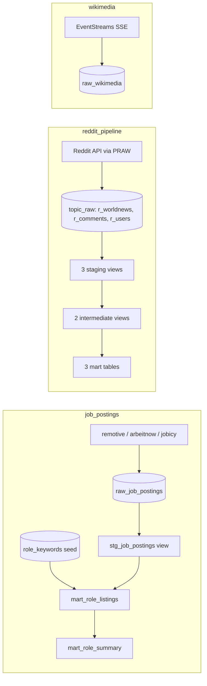

# AGENTS.md

Orientation for the `AmanLP7/dbt` checkout: three Databricks pipelines sharing one
SQL warehouse, one credential flow, and one Python environment.

- **Hard invariants** live in `.omp/RULES.md`. OMP loads that file in every project
  directory (via symlinks); §7 summarizes it, the rules file is authoritative.
- **Per-project detail** is in each project's `README.md`.
- This file is the map: what lives where, how data moves, and which command runs what.

## 1. Warehouse access

Ad-hoc Databricks SQL goes through the MCP server `databricks`; the CLI and
`databricks-sql-connector` are fallback only. The invariants that govern this are in
`.omp/RULES.md` — the material below is context, not a second copy of the rules.

| Schema | Holds | Written by |
| --- | --- | --- |
| `workspace.job_postings` | `raw_job_postings`, seed `role_keywords`, `stg_job_postings`, `mart_role_listings`, `mart_role_summary` | `job_postings` extractor, then `dbt build` |
| `workspace.reddit` | 3 staging views, 2 intermediate views, 3 mart tables | `reddit_pipeline` `dbt build` |
| `workspace.topic_raw` | `r_worldnews`, `r_comments`, `r_users` | `reddit_pipeline` extractors |
| `workspace.wikimedia` | `raw_wikimedia` (append-only) | `wikimedia` consumer |

The single service principal holds `USE_CATALOG` on `workspace` plus `USE_SCHEMA` and
`SELECT` on all four schemas (granted 2026-10-18), so every schema — `job_postings`
included — is readable through the same server. There is no per-schema server to
choose between, and the grants are not a boundary between them.

The server advertises only `execute_sql_read_only` and `poll_sql_result`, and its
principal is `SELECT`-only, so the MCP path cannot write. The fallback identity is
different: the Databricks user the CLI and connector authenticate as owns all four
schemas and every table in them — recorded in the `information_schema` owner columns,
not as grants — including every dbt-produced relation. The fallback channel can
therefore write, which is why the write gate in `.omp/RULES.md` is absolute; read
there for the error taxonomy and fallback conditions.

Authentication is the Databricks CLI profile `DEFAULT`; an ambient `DATABRICKS_PAT`
is stale — do not use it.

MCP registration is per working directory. OMP reads only the `.omp/` of its cwd and
does not walk ancestors, so each project carries symlinks to the root
`.omp/{mcp.json,config.yml,RULES.md}`. A new project directory needs the same three
links before a session starts inside it; links added mid-session take effect only
after a restart.

## 2. Repository map

| Path | What it is |
| --- | --- |
| `.omp/` | OMP settings shared by all three projects: `mcp.json` (the read-only SQL server), `config.yml` (deny rule and access notes), `RULES.md` (hard invariants). |
| `.venv/` | The only Python environment in the checkout; no project directory has one. |
| `AGENTS.md` | This orientation. |
| `dbt_readme.md` | Personal dbt notes. Gitignored; not authoritative for this repo. |
| `logs/` | Root dbt log output. Gitignored. |
| `job_postings/` | dbt project + keyless job-board extractors + Dagster code location. |
| `reddit_pipeline/` | dbt project + Reddit extractors + Dagster code location + agent skills. |
| `wikimedia/` | Speed-layer consumer for the Wikimedia EventStreams firehose. No dbt project. |

There is **no root-level dbt project**. `dbt` resolves `dbt_project.yml` from the
current directory, so run it from inside `job_postings/` or `reddit_pipeline/`.

## 3. Data flow



Each pipeline is independently runnable: extractors and the consumer are plain Python
modules, and dbt runs from inside the project directory. Dagster wraps the same steps
in one ordered job and adds retries, asset checks, and (for `job_postings`) a stopped
daily schedule.

## 4. Projects

### `job_postings/`

ELT over three keyless job-board APIs. The extractor normalises each board's payload
into the shared raw schema and applies no role filter; role matching is a SQL concern
applied in the marts against a seed.

| Path | Contents |
| --- | --- |
| `models/staging/jobs/` | `stg_job_postings` (view) — newest fetch per `(source, source_job_id)`, `job_key`, normalised title, unpacked tags, stripped HTML — plus `src_jobs.yml` (source `jobs.raw_job_postings`, 4 source tests) and `stg_jobs.yml` (3 model tests). |
| `models/marts/jobs/` | `mart_role_listings` and `mart_role_summary` (tables), 7 model tests, all declared in `marts.yml`. |
| `seeds/role_keywords.csv` | 11 keywords across 4 role families; the taxonomy the marts join against. |
| `ingestion/jobs/` | `fetch_job_postings.py` (remotive in one request; arbeitnow and jobicy paginated, with pacing between pages) and `_common.py` (env validation, DDL, chunked parameterised inserts). |
| `orchestration/` | Dagster code location `job_postings_orchestration.definitions`: job `job_board_refresh`, assets `jobs/raw_job_postings` + 4 dbt assets, 14 asset checks, schedule `daily_job_board_refresh` (cron `0 6 * * *`, ships stopped). |
| `tests/` | Offline pytest: extractor mappings, raw-table contract, seed contract, Dagster wiring, extractor asset. |
| `profiles/profiles.yml` | target `dev`, catalog `workspace`, schema `job_postings`. |

- `raw_job_postings` is append-only and stamped `ingested_at`; dedupe happens in
  staging on the newest row per `(source, source_job_id)`.
- Mart matching is a case-insensitive substring of the normalised title with no word
  boundary — `ai engineer` also matches "Dubai engineer". Wildcard characters in a
  keyword are rejected by `test_seed_contract.py`.
- `open_listings` means "postings seen and not re-listed differently", not "jobs open
  today": nothing expires from the raw table.

### `reddit_pipeline/`

ELT over r/worldnews posts, their comments, and commenter profiles.

| Path | Contents |
| --- | --- |
| `models/staging/reddit/` | `stg_reddit_posts`, `stg_reddit_comments`, `stg_reddit_users` (views), with `src_reddit.yml` and `stg_reddit.yml`. |
| `models/intermediate/reddit/` | `int_posts_enriched`, `int_comments_enriched` (views) — joins and business logic. |
| `models/marts/reddit/` | `mart_post_summary`, `mart_user_metrics` (tables), `mart_comment_history` (incremental, merge). All three call `add_audit_fields()`. |
| `ingestion/reddit/` | One module per entity plus `_common.py`: clients, env validation, table setup, both load strategies. |
| `orchestration/` | Dagster code location `reddit_pipeline_orchestration.definitions`: job `reddit_refresh`, 11 assets (3 extractors + 8 dbt), 28 asset checks, no schedule. |
| `macros/` | `add_audit_fields()` and `window_hours()` (the dbt-side 5-hour window). |
| `tests/` | Offline pytest: extractors, Dagster wiring, extractor assets, window contract. |
| `.agents/skills/` | Skills `lint-and-typecheck`, `dbt-model-conventions`, `reddit-extraction`; list them from this directory with `omp skill list`. |
| `profiles/profiles.yml` | target `dev`, catalog `workspace`, schema `reddit`. |

- Sources are `workspace.topic_raw.{r_worldnews,r_comments,r_users}`. Freshness
  thresholds (12 h warn, 24 h error on `ingested_at`) are declared but inert: no job
  or CI step runs `dbt source freshness`, and `dbt build` does not check freshness.
- Posts and comments use a rolling 5-hour window: delete the window, insert the
  fetched rows inside it, keep older rows. Users use a key-based upsert.
- The DELETE and INSERT are separate statements, so a failure between them leaves the
  window rows absent; a retry re-fetches and rewrites them.
- 4 of the 28 asset checks are `relationships` tests marked `severity: warn`, so a
  green build does not prove referential integrity.

### `wikimedia/`

Speed layer only, not a dbt project. `ingestion/wikimedia/consume_recentchange.py`
tails the public SSE firehose and micro-batches into `workspace.wikimedia.raw_wikimedia`
(500 rows or 15 s). The table is append-only, so a replayed batch costs duplicates,
not history. The resume checkpoint (`.state/last_event_id.json`) is written after the
insert, so it can only trail the data. Batch and serving layers are not built.

## 5. Shared conventions

### dbt project shape

- One dbt project per pipeline; each `dbt_project.yml` names the project and its
  profile.
- Materialisation is keyed by layer directory in `dbt_project.yml` and inherited by
  source-named subfolders: `staging` → view, `intermediate` → view (reddit only),
  `marts` → table. A model can override it with `{{ config(...) }}`
  (`mart_comment_history` does).
- Each layer keeps one subfolder per source — `jobs/`, `reddit/` — so a second source
  sits beside the first without changing the layer config.
- Sources are declared in `models/staging/<source>/src_*.yml`. `reddit_pipeline` pins
  `workspace.topic_raw`; `job_postings` resolves `JOB_POSTINGS_CATALOG` /
  `JOB_POSTINGS_SCHEMA` with the target as fallback, matching the extractor.
- Seeds exist only in `job_postings`. `analyses/`, `snapshots/`, and reddit's
  `seeds/` are placeholders.
- Macros live in `macros/`; sqlfluff resolves them via `load_macros_from_path`.
- `tests/` is both dbt's singular-test directory and pytest's directory. dbt reads
  only `.sql` from it, so the Python suite is invisible to dbt.

### Python and credentials

- Python 3.10. Both dbt projects configure ruff (line length 120) and pyright in
  `pyproject.toml` and carry a `.sqlfluff` for the `databricks` dialect;
  `wikimedia/pyproject.toml` configures ruff and pyright only.
- Install into the root `.venv`, never as `uv tool` copies — `~/.local/bin` precedes
  the pyenv shims and would shadow the environment's `dbt`/`python`.
- Configuration is per-project `.env`, copied from `.env.example` and gitignored.
  Extractors call `load_dotenv()`; **dbt does not read `.env`**.
- One `databricks auth login` covers everything. Extractors hand the SQL connector a
  credentials provider; Dagster mints `DATABRICKS_TOKEN` immediately before each dbt
  run; a manual `dbt` needs the token exported first.
- The ambient `DATABRICKS_PAT` is stale and rejected — do not use it.

### Profiles and dbt invocation

Both dbt projects commit `profiles/profiles.yml`. `reddit_pipeline/` also carries a
`profiles.yml` symlink to it, so a bare `dbt` there finds the repo profile;
`job_postings/` has no such symlink, and a bare `dbt` there resolves
`~/.dbt/profiles.yml`. Passing the directory explicitly works in both:

```bash
DBT_PROFILES_DIR=profiles dbt build
```

### Testing and CI

- Offline pytest (stubbed HTTP and warehouse) is the pre-merge gate. dbt's own tests
  need a warehouse and run inside `dbt build`.
- `job_postings` pytest reads `target/manifest.json`, so run `dbt parse` first on a
  fresh checkout. `reddit_pipeline`'s `conftest.py` parses the project itself.
- Both dbt projects carry `.github/workflows/ci.yml`; `wikimedia/` has no workflow.
  GitHub Actions reads workflows only from the repository root
  `.github/workflows`, which this checkout does not have, so in the current layout
  these are local definitions rather than running CI.

## 6. Commands

Run from the project directory. `dbt build` writes to the warehouse; the write gate in
`.omp/RULES.md` governs hand-written statements, not the build itself.

| Task | `job_postings/` | `reddit_pipeline/` |
| --- | --- | --- |
| Install | `pip install -r requirements.txt -r requirements-dev.txt -e orchestration` | same |
| Parse (no warehouse) | `DBT_PROFILES_DIR=profiles dbt parse` | same |
| Build + test | `DBT_PROFILES_DIR=profiles dbt build` | same |
| Extract/load only | `python -m ingestion.jobs.fetch_job_postings` | `python -m ingestion.reddit.extract_reddit`, `…_comments`, `…_users` |
| Orchestrated run | `dagster asset materialize -m job_postings_orchestration.definitions --select '*'` | `dagster asset materialize -m reddit_pipeline_orchestration.definitions --select '*'` |
| UI + scheduler | `dagster dev` (from `orchestration/`) | `dagster dev` (from `orchestration/`) |
| Offline tests | `pytest` | `pytest` |
| Lint / types | `ruff format --check . && ruff check . && sqlfluff lint && pyright` | same |

`wikimedia/`: `pip install -r requirements.txt -r requirements-dev.txt`, then
`python -m ingestion.wikimedia.consume_recentchange --max-events 200` for a bounded
run; `pytest -q` for its offline tests.

## 7. Rules at a glance

The authoritative text is `.omp/RULES.md`. Summary:

| Rule | Applies to |
| --- | --- |
| Ad-hoc Databricks queries go through the MCP server `databricks`. CLI and connector are fallback only. | every manual query |
| A SQL-level `FAILED` means the query is wrong — fix it on MCP. `[OP_NOT_SUPPORTED_READ_ONLY]` means it was a write — stop. | interpreting MCP errors |
| HTTP 403 is a denial to report. HTTP 401 means the session's cached token expired — restart the session. Neither licenses a CLI workaround. | transport errors |
| A fallback is read-only (`SELECT`, `SHOW`, `DESCRIBE`, `EXPLAIN`) and is never run in parallel with MCP to compare. The one non-error reason: determining what the fallback identity itself may do. | fallback path |
| Never write to a relation `dbt build` produces. Any write needs an explicit yes for that exact statement. | writes |
| `databricks auth token --profile DEFAULT` is always allowed. | credential plumbing |

## 8. Gotchas

- `dbt show --inline` and `dbt run-operation` execute SQL through the write-capable
  profile — they are ad-hoc queries, not pipeline runs.
- Unqualified table names resolve differently by channel: MCP and the raw connector
  fall back to `system.session, system.builtin, system.ai, workspace.default`, while
  dbt uses the active profile's schema (`job_postings` or `reddit`). Qualify names.
- `.venv` exists only at the checkout root; the project directories have none.
- `job_postings` pytest needs a prior `dbt parse`; reddit's does not.
- Dagster's schedule for `job_postings` ships stopped; `reddit_refresh` has no
  schedule at all. Nothing writes to the warehouse on its own.
- `dagster dev` sets `DAGSTER_IS_DEV_CLI`, so the code location's `prepare_if_dev()`
  runs `dbt parse` at import and the profile's `env_var(...)` values must be present
  then. Outside `dagster dev`, `job_postings` never parses on import: its pytest and
  `dagster definitions validate` need a prior `dbt parse`. `reddit_pipeline` parses
  on import only when `target/manifest.json` is missing.
