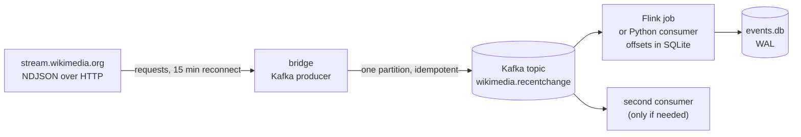

# kafka_streams

Kafka flows. One shared broker and one Python environment per checkout; each flow
owns its topic, its sink, and its code. A flow that runs on Apache Flink gets a
second environment (`.flink-venv`) because PyFlink pins `protobuf<6` and dbt needs
`protobuf>=6`.

|Path|What it is|
|---|---|
|`docker-compose.yml`|Single-node Kafka (KRaft), 512 MiB heap under a 1 GiB limit, advertised on `localhost:9092`, retention 7 days. One broker for every flow.|
|`requirements.txt`, `requirements-dev.txt`|Shared client and tooling dependencies (`confluent-kafka`, `requests`, `python-dotenv`).|
|`requirements-flink.txt`|PyFlink for flows that run on Flink. Install into `.flink-venv`, never into `.venv`: it downgrades `protobuf` and breaks dbt.|
|`.flink-venv/`|PyFlink environment (JDK 17 needed separately). Gitignored. Only Flink entry points run from it.|
|`wikimedia/lib/`, `bluesky/lib/`|Connector jars for the Flink jobs, fetched by `fetch-jars.sh` and built by `build-sqlite-dialect.sh` (also gitignored). Each flow carries its own copy; `JARS` is part of the flow.|
|`pyproject.toml`|ruff and pyright for the whole tree.|
|`.env.example`|Copy to `.env`; holds `KAFKA_BOOTSTRAP_SERVERS` plus flow-prefixed keys. `python-dotenv` finds it by walking up from the calling module.|
|`wikimedia/`|Flow: Wikimedia EventStreams → Kafka → SQLite, read by a Flink SQL job or a Python consumer. See `wikimedia/README.md`.|
|`bluesky/`|Flow: Bluesky Jetstream (v2, WebSocket) → Kafka → SQLite. One reader: a Flink SQL job. Resumes from a persisted upstream cursor. See `bluesky/README.md`.|

```bash
cp .env.example .env
pip install -r requirements.txt -r requirements-dev.txt
docker compose up -d
cd wikimedia && python -m ingestion.wikimedia.producer --create-topic
cd bluesky && python -m ingestion.bluesky.producer --create-topic
```

## Adding a flow

1. Create `kafka_streams/<flow>/` with `ingestion/<flow>/`, `tests/`, `README.md`.
   Name the test module after the flow (`tests/test_<flow>_flow.py`): pytest's
   default import mode identifies a test file by its basename, and every flow has
   one `tests/` directory. `kafka_streams/conftest.py` merges the flows' top-level
   `ingestion` packages so one `pytest` run collects all of them.
2. Give it its own topic and its own SQLite file (`<flow>/data/<flow>.db`); do not
   share a database file between flows. WAL allows one writer, so two consumers on
   one file will interleave their offsets.
3. Add its keys to `.env.example` under a `<FLOW>_` prefix.
4. Reuse the broker in `docker-compose.yml`. Do not start a second broker — the
   advertised listener is per-broker, and two of them will fight over port 9092.

## Analysis behind the design

`wikimedia/` and `bluesky/` are built; `bluesky/README.md` carries its own analysis.
The rest of this document is the analysis that shaped `wikimedia/` — what Kafka buys
over the direct-to-warehouse consumer, what the stream actually costs, and where the
correctness traps are. Numbers were measured on this checkout on 2026-10-20; anything
not measured is marked `[INFERENCE]`.

Scope: whether the Wikimedia EventStreams firehose — previously consumed directly into
`workspace.wikimedia.raw_wikimedia` by a top-level `wikimedia/` consumer, removed on
2026-10-20 — should be re-fronted with Kafka, and what that costs and breaks. That table
does not exist on this workspace (`databricks schemas get workspace.wikimedia` →
`Schema 'workspace.wikimedia' does not exist`), and nothing writes it.

## 1. Verdict

| Question | Answer |
|---|---|
| Can Kafka read Wikimedia's API directly? | No. The public door is HTTP (SSE or NDJSON); the Kafka brokers behind it are WMF-internal. |
| Does a bridge work? | Yes: `requests` → NDJSON → producer. ~100 lines, reusing `open_stream()`. |
| What does Kafka actually buy here? | Fan-out (one upstream read, N consumers) and sink isolation (broker buffers while SQLite is down). Not durability: the stream is already replayable. |
| Is it cheap locally? | Yes. ~279–338 MiB RSS measured. Disk is the only real cost, ~3.2 GiB/day at 7-day retention ≈ 22 GiB. |
| Is it worth it today? | Only if a second consumer appears. For one consumer, two changes to the existing code get more reliability for less machinery (§6). |

## 2. What Wikimedia exposes

Source: <https://wikitech.wikimedia.org/wiki/Event_Platform/EventStreams>
(canonical: `Event_Platform/EventStreams_HTTP_Service`).

| Fact | Consequence |
|---|---|
| Server is Kafka, exposed through KafkaSSE over HTTP | Internal brokers (`stream-internal.wikimedia.org`) are WMF-only; no public bootstrap address exists |
| `Accept: text/event-stream` → SSE; `Accept: application/json` → NDJSON | NDJSON removes the `event:` / `id:` / `data:` frame parsing entirely |
| No server-side filtering or projection | Volume is fixed by the upstream rate; filtering happens downstream |
| Connection timeout enforced at 15 minutes | Any consumer must reconnect on a timer, not just on error |
| Multi-DC active/active; `id:` carries **timestamps**, not offsets | Offsets are not a stable cursor across DCs |
| Canary events must be discarded: `meta.domain === 'canary'` | A filter step is mandatory, not optional |
| Historical consumption since 2018-06 via `?since=<ISO-8601>` or `Last-Event-ID` with `timestamp` | Replay from the past **is** available; retention is stated as likely 7–31 days |

The replay fact matters. The retired consumer's `read_checkpoint()` returned `None` on
`FileNotFoundError`, `OSError`, **and** `JSONDecodeError`, and its caller treated `None`
as "live edge", so a corrupt or missing state file lost the gap silently. `since=` makes
that recoverable and that code never used it.

The Kafka flow does not use `since=` either, but it does not need to: its cursor is the
topic's own offsets. A missing or unreadable SQLite file starts at the earliest retained
offset (§ `start_offset`), so the worst case is a replay, never a silent gap.

## 3. Measured volume

Two captures off the live stream, same machine, same day.

| Run | Window | Events | Data bytes | Bytes/event | Rate |
|---|---|---|---|---|---|
| A | 12.7 s | 307 | 479,625 | 1,562 | 24.2 ev/s |
| B | 60.3 s | 1,846 | 2,364,935 | 1,281 | 30.6 ev/s |

Derived from run B: **38 KiB/s**, **3.16 GiB/day** (~3.39 GB/day), **~102 GB/month**
uncompressed.

Other observations from run B:

- Offsets `6622944011` → `6622945856`, contiguous and unique; a single topic
  `eqiad.mediawiki.recentchange` (the other DC topic, `codfw.…`, is the active/active
  peer).
- 97 of 307 events in run A were bot edits (~32%). Filtering them cuts ~1/3 of the
  volume if full history is not wanted.
- 42 distinct wikis in 12.7 s — the stream is dominated by a long tail, so partitioning
  by `wiki` gives many small partitions.

At 30 ev/s no design here is throughput-limited. This is a correctness exercise, not a
performance one.

## 4. Topology



Three processes instead of one: bridge, broker, reader. Each needs supervision; the
retired `consume_recentchange.py` was a single process. The reader is a Flink job or a
Python consumer, never both at once on one SQLite file.

## 5. Bridge design

- **Transport.** `Accept: application/json` → one JSON object per line. Reuse the URL and
  header shape from `consume_recentchange.py:101`.
- **Reconnect.** The server closes at 15 minutes. `DEFAULT_READ_TIMEOUT = 90.0` and
  `DEFAULT_BACKOFF_SECONDS = (1, 5, 15, 30, 60)` already express the right shape; the
  reconnect timer is new.
- **Cursor.** Track `id:` as a timestamp. On restart, replay with
  `Last-Event-ID: {"timestamp":…}` or `?since=` rather than resuming from a bare offset.
- **Filter.** Drop `meta.domain == 'canary'`. Optionally drop `bot == true`.
- **Idempotency.** `payload.meta.id` is a UUID. Use it as the dedupe key end to end;
  produce at-least-once and let the sink ignore duplicates. Committing the SSE position
  and the broker write are two stores, so no exactly-once claim is honest here.
- **Serialisation.** Ship the raw JSON string as the message value. No schema, no
  registry, no re-encoding — the consumer writes the same bytes the upstream sent.

## 6. Consumer correctness

This is the part that decides whether the design is right or subtly wrong.

**Do not use Kafka's committed offsets as the source of truth.** Committing to Kafka
after writing SQLite recreates the exact two-store gap the current code already has,
between `append_rows(...)` and `write_checkpoint(...)` in `drain()`
(`consume_recentchange.py:178`). With the connector's default `autocommit=True`, the
INSERT is durable before the checkpoint write, so a crash between them replays a batch.
The reverse ordering would lose one. Neither is acceptable when a single transaction can
express it.

Store the offset **in SQLite, in the same transaction as the rows**:

```python
with db:  # one COMMIT covers both statements
    db.executemany(
        "INSERT OR IGNORE INTO events (event_id, ingested_at, payload) VALUES (?, ?, ?)",
        rows,
    )
    db.execute(
        "UPDATE kafka_offsets SET next_offset = ? WHERE topic = ? AND partition = ?",
        (offset + 1, topic, partition),
    )
```

Consequences:

| Choice | Why |
|---|---|
| `assign()` + `seek()` instead of `subscribe()` | Offsets come from SQLite, not the group coordinator. One consumer, so no rebalancing to lose. |
| `INSERT OR IGNORE` on `meta.id` | Makes at-least-once replay a no-op; the bridge may duplicate freely. |
| One partition | Total arrival order for an append-only table. 30 ev/s is nowhere near a partition limit. Partition by `wiki` only if per-wiki parallelism ever matters. |
| `autocommit=False` | The whole point; a default connection defeats it. |

## 7. Target schema

Proposed, not created:

```sql
PRAGMA journal_mode = WAL;
PRAGMA synchronous = NORMAL;
PRAGMA busy_timeout = 5000;

CREATE TABLE events (
    event_id    TEXT PRIMARY KEY,   -- payload.meta.id (UUID)
    ingested_at TEXT NOT NULL,
    event_dt    TEXT,
    topic       TEXT,
    offset      INTEGER,
    wiki        TEXT,
    type        TEXT,
    title       TEXT,
    user        TEXT,
    bot         INTEGER,
    payload     TEXT NOT NULL
);

CREATE TABLE kafka_offsets (
    topic       TEXT NOT NULL,
    partition   INTEGER NOT NULL,
    next_offset INTEGER NOT NULL,
    PRIMARY KEY (topic, partition)
);
```

**Measured write capacity:** 200 transactions × 500 rows at 1,378-byte payloads, WAL +
`synchronous=NORMAL` → 100,000 rows in **1.90 s**, i.e. **52,616 rows/s**. File size
159.8 MiB for 131.4 MiB of payload (~1.22× overhead). The stream at 30 ev/s needs
0.06% of that headroom; SQLite is chosen for atomicity, not speed.

WAL permits concurrent readers with exactly **one writer**. Enforce that with a lockfile
or a single supervisor; two consumer processes will interleave and corrupt the offset
invariant.

## 8. Running a broker on this box

### Image facts (measured, not from docs)

`apache/kafka:4.3.1` (pinned in the compose file; the same image is
amd64 digest `sha256:77e3df9054047a88b520d0cc46e16696d3b22022e1d580aeccd2632df6532837`, 686 MB):

| Property | Value |
|---|---|
| `CMD` | `/etc/kafka/docker/run` |
| `ENTRYPOINT` | `/__cacert_entrypoint.sh` |
| `USER` | `appuser` |
| JVM | `jdk-21.0.11+10` |
| `KAFKA_HEAP_OPTS` in image env | **absent** — the default comes from the start script |

```
/opt/kafka/bin/kafka-server-start.sh:28:if [ "x$KAFKA_HEAP_OPTS" = "x" ]; then
/opt/kafka/bin/kafka-server-start.sh:29:    export KAFKA_HEAP_OPTS="-Xmx1G -Xms1G"
/opt/kafka/bin/kafka-run-class.sh:278:if [ -z "$KAFKA_HEAP_OPTS" ]; then
/opt/kafka/bin/kafka-run-class.sh:279:  KAFKA_HEAP_OPTS="-Xmx256M"
```

The 256M default applies only to the CLI tools; `kafka-server-start.sh` exports its own
value before calling `run-class`, so the **broker** gets 1 GiB.

### Measured footprint

| Configuration | RSS idle | RSS after 200k messages |
|---|---|---|
| default (`-Xmx1g -Xms1g`) | 293 MiB | 338 MiB |
| `KAFKA_HEAP_OPTS=-Xmx512m -Xms512m` | 279 MiB | not measured |

The JVM commits pages lazily, so `-Xmx` is a ceiling, not a reservation. Overhead beyond
the heap is real — metaspace, code cache, GC structures, thread stacks, plus mmap'd log
segments that land in page cache (measured inside the cgroup: `anon` 308 MiB, `file`
29 MiB, `slab` 2 MiB at 343 MiB total). `[INFERENCE]` plan ~1.3–1.5 GiB at a full 1 GiB
heap.

`KAFKA_JVM_PERFORMANCE_OPTS` defaults to
`-server -XX:+UseG1GC -XX:MaxGCPauseMillis=20 -XX:InitiatingHeapOccupancyPercent=35
-XX:+ExplicitGCInvokesConcurrent -XX:MaxInlineLevel=15`. G1 starts concurrent marking at
35% occupancy and grows toward `-Xmx` under load; `-Xms512m` avoids re-committing pages
repeatedly.

### The OOM risk is real, and demonstrable

The kernel does not ask which process to kill. It scores candidates and kills the
highest. With no cgroup limit, the cgroup is the whole WSL VM — so the victim can be
Dagster, `dockerd`, or an unrelated shell.

Demonstrated on this machine:

```
docker run --rm --memory=128m --memory-swap=128m --shm-size=512m \
  --entrypoint dd alpine if=/dev/zero of=/dev/shm/blob bs=1M count=200

docker inspect → ExitCode=137  OOMKilled=true
```

`137` = 128 + SIGKILL. With `restart: unless-stopped` that becomes a silent crash loop
rather than an error you see.

Host state at time of measurement: 7.57 GiB RAM, 2.0 GiB swap, WSL2 with no
`.wslconfig` (so ~50% of host RAM), `overcommit_memory=0`, `panic_on_oom=0`. Dagster
already runs five processes at 350–850 MiB each.

### Defenses — use both

| Defense | Effect | Failure if omitted |
|---|---|---|
| `KAFKA_HEAP_OPTS=-Xmx512m -Xms512m` | Makes Kafka smaller | Grows toward ~1.4 GiB and starves Dagster |
| `--memory=1g` / `deploy.resources.limits.memory` | Makes the blast radius Kafka-only | Kernel picks whatever is fattest |

The limit must exceed heap + off-heap. Measured 279 MiB idle and several hundred MiB
under light load for a 512 MiB heap, so 1 GiB leaves comfortable headroom.

```yaml
services:
  kafka:
    image: apache/kafka:4.3.1
    environment:
      KAFKA_HEAP_OPTS: "-Xmx512m -Xms512m"
      KAFKA_LOG_DIRS: "/var/lib/kafka/data"
      KAFKA_NODE_ID: "1"
      KAFKA_PROCESS_ROLES: "broker,controller"
      KAFKA_LISTENERS: "PLAINTEXT://:9092,CONTROLLER://:9093"
      KAFKA_ADVERTISED_LISTENERS: "PLAINTEXT://localhost:9092"
      KAFKA_CONTROLLER_LISTENER_NAMES: "CONTROLLER"
      KAFKA_LISTENER_SECURITY_PROTOCOL_MAP: "CONTROLLER:PLAINTEXT,PLAINTEXT:PLAINTEXT"
      KAFKA_CONTROLLER_QUORUM_VOTERS: "1@localhost:9093"
      KAFKA_OFFSETS_TOPIC_REPLICATION_FACTOR: "1"
      KAFKA_TRANSACTION_STATE_LOG_REPLICATION_FACTOR: "1"
      KAFKA_TRANSACTION_STATE_LOG_MIN_ISR: "1"
      KAFKA_GROUP_INITIAL_REBALANCE_DELAY_MS: "0"
    ports:
      - "127.0.0.1:9092:9092"
    volumes:
      - kafka-data:/var/lib/kafka/data
    deploy:
      resources:
        limits:
          memory: 1g
    restart: unless-stopped
```

Notes:

- **`KAFKA_LOG_DIRS` is not optional.** The image regenerates
  `/opt/kafka/config/server.properties` from `KAFKA_*` env vars, and without this
  one `log.dirs` falls back to `/tmp/kafka-logs` — outside the named volume. The
  topic then vanishes on any container recreation (`docker compose down`, or an
  image/env change) even though the SQLite checkpoint survives. Verified:
  with the variable set, `/opt/kafka/config/server.properties` reads
  `log.dirs=/var/lib/kafka/data` and the volume holds `__cluster_metadata-0`.
- **Healthcheck is a TCP probe.** `kafka-topics.sh` would start a second JVM every
  10 s inside the same 1 GiB cgroup as the broker.
- KRaft has no ZooKeeper, so a single node must be both broker **and** controller. Omitting
  `KAFKA_CONTROLLER_LISTENER_NAMES` or `KAFKA_CONTROLLER_QUORUM_VOTERS` is the usual
  "starts then dies" case.
- `ADVERTISED_LISTENERS` is what clients actually connect to. From this shell that is
  `localhost:9092`. If the bridge or consumer later runs in a container, they need
  `kafka:9092` — use two advertised listeners rather than reusing one name. Mismatch here
  is the most common single-node failure.
- `ports` binds loopback only. Nothing outside the VM needs the broker.

Verified on this machine: Docker Engine 29.9.1, `overlayfs`, cgroup v2 with the `systemd`
driver, compose v5.6.0, buildx v0.38.0, `systemd` enabled and active. The broker started,
accepted 200,000 messages, and reported the expected log offsets.

## 9. Cost

Local Kafka replaces warehouse **uptime**, not storage. The relevant comparison:

| Option | Compute model | Monthly |
|---|---|---|
| SQLite only (current direction) | none | ~$0 |
| Kafka locally + SQLite | container on this box | ~$0 marginal (RAM/disk only) |
| Databricks, 15 s flush | 730 h: the warehouse never auto-stops | ≈ $2,044 |
| Databricks, hourly batch | 24 runs/day, ~2 min each + 1 min auto-stop | ≈ $101 |
| Databricks, every 6 h | 4 runs/day, same | ≈ $17 |
| Databricks, daily | 1 run/day, same | ≈ $4 |

Basis, read from the account's own billing tables on 2026-10-27 rather than a pricing
page: warehouse `5c5d597ca7af9460`, `Serverless Starter Warehouse`, `XXSMALL` (2X-Small),
serverless `PRO`, `auto_stop_mins: 1`, AWS `us-west-2`. `system.billing.list_prices`
gives `PREMIUM_SERVERLESS_SQL_COMPUTE_US_WEST_OREGON` = **$0.70/DBU**; 2X-Small
serverless SQL is **4 DBU/hour**
(<https://learn.microsoft.com/en-us/azure/databricks/resources/pricing>) → **$2.80/hour**.
The batch rows assume 2 minutes of compute per run plus the 1-minute auto-stop, which is
an assumption; the per-hour rate is not. Storage is ~20–35 GB/month compressed, billed
separately under `PREMIUM_DATABRICKS_STORAGE_US_WEST_OREGON`.

The 15 s flush is what makes continuous billing: `DEFAULT_FLUSH_SECONDS = 15.0`
(`_common.py:61`) against a 1-minute auto-stop never lets the warehouse idle.

Measured, not extrapolated: `system.billing.usage` for this warehouse over the last three
days is 6.85, 2.14 and 0.61 DBU — **$4.79, $1.50 and $0.42**. A pipeline that runs and
then stops costs cents per day; one that never stops costs $2,044 a month.

## 10. What was built, and what would change the verdict

Built as designed above, and the old direct-to-warehouse consumer was deleted. The flow
is `wikimedia/ingestion/wikimedia/producer.py` (NDJSON bridge, canary filter, idempotent
producer) plus two interchangeable readers of the same topic and sink:
`wikimedia/ingestion/wikimedia/flink_job.py` (Flink SQL, cursor healed from the rows)
and `wikimedia/ingestion/wikimedia/consumer.py` (manual assignment from the SQLite
checkpoint, one transaction per batch),
`docker-compose.yml` (single-node KRaft, capped at 1 GiB), and the two tables in
`wikimedia/data/wikimedia.db`. The cheaper alternative at the end of this section was
also implemented, in SQLite form: the offset advances in the same transaction as the
rows.

What would justify a second flow:

1. **A second consumer.** One local SQLite sink and one warehouse sink, reading the
   stream once instead of twice. Each additional consumer otherwise re-downloads from
   Wikimedia.
2. **Sink downtime tolerance.** The broker buffers while SQLite is down; today the
   consumer must replay a 7–31 day window.

What would not: performance (30 ev/s), durability (already replayable), or operational
simplicity (three processes instead of one).

Cheaper alternative that captures most of the reliability benefit, without Kafka:
write the checkpoint row **in the same SQLite transaction** as the event rows, and resume
with `since=`/`Last-Event-ID` instead of starting at the live edge. Those two changes
close the loss window in §6 and §2 with no new process, no JVM, and no broker.
